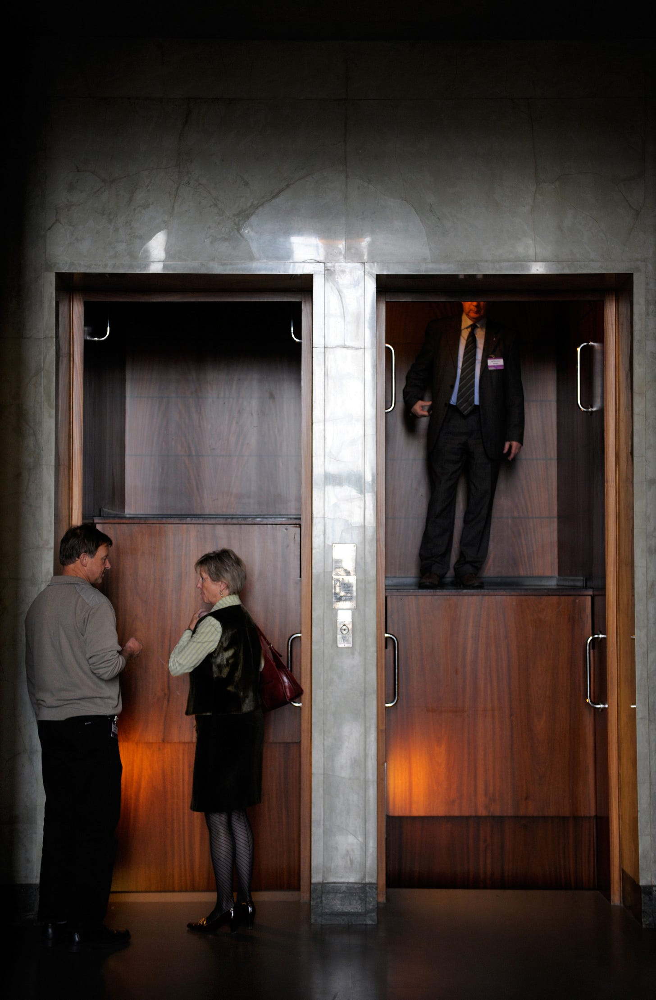

<em>[Epistemic status &#8211;&nbsp;written quickly for <a href="http://inkhaven.blog">Inkhaven</a>]</em>

We already price in road deaths when building new roads with the statistical value of a life to figure out if the build is positive expected value. This implies the correct number of transport-related deaths and serious injuries is not zero &#8211; if it was then we would just ban roads, trains, trams and planes.

<a href="https://www.jefftk.com/p/make-buses-dangerous">Jeff Kaufman proposes making buses more dangerous</a>. Buses are already far safer than cars but are unpopular (at least in US metro areas). To improve them you can make route changes, such as spacing out/consolidating stops, removing detours, and minimising turns across traffic. But you can also just make them faster at the cost of safety:
<ul><li>
Higher speed limits &#8211; much of London now has a speed limit of 20mph, which on e.g. the Old Kent Road is preposterous and means buses crawl along a huge road through an area with few pedestrians.
</li><li>
Allow drivers to pull away while someone is still paying. Contactless payment is a no-brainer, and the payment terminals can be moved inside the bus instead of at the entrance so people can board quickly instead of clustering around the doorway.
</li><li>
Leave bus doors open in the city so that people can hop on and off at their own risk in low-speed areas. London used to have this with the old Routemasters, but the <a href="https://en.wikipedia.org/wiki/New_Routemaster">New Bus for London</a> eliminated this feature despite having doors at the rear. Allows people to board outside of bus stops or when the bus is stopped at the lights.
</li><li>
Allow people off when the bus is stuck in heavy traffic. Especially in congested cities like London buses can get stuck, and if you&#8217;re between stops you can&#8217;t get off. In this situation, stuck in stationary traffic on Waterloo Bridge, I&#8217;ve had the driver tell me I can use the emergency button to open the door but that he wasn&#8217;t allowed to.
</li></ul>
We can give other modes of transport the same treatment:
<ul><li>
<strong>Trains</strong>: use driver-operated doors<a href="#fn-1" class="sidenote-toggle">1</a><strong>1.</strong> All trains should have driver-operated doors, where the driver looks on CCTV to see if the train is fully in the station, instead of having a guard who opens one set of doors, checks, and then releases the rest of the doors. It reduces dwell time and eliminates the need for a guard. Unsurprisingly, unions hate this and in the UK they&#8217;ve worked for years to prevent this in spite of guarantees that the guard won&#8217;t be eliminated (see the Southern and SWR strikes)., and unlock the doors before the train has come to a complete stop. (Some older metro stock allows this, but modern fleets do not.)
</li><li>
<strong>Planes</strong>: reduce the ridiculous theatre at security checkpoints. A lot of this has already been implemented in a perverse way &#8211; not by just abandoning the liquid restrictions and requirement to take laptops out but by spending billions installing CT scanners to produce 3D images. We could just remove the requirement altogether and skip future expensive upgrades. Taking off your shoes has been binned, thankfully.
</li><li>
<strong>Bicycles</strong>: remove mandatory helmet laws, which dissuade people from cycling. Implement Idaho stops, where cyclists can treat red lights as stop signs.
</li><li>
<strong>Walking</strong>: allow jaywalking, shorten pedestrian waits at signals, remove guardrails (which are often safety-negative for cyclists anyway).
</li></ul>
Shaving off seconds from everyone&#8217;s journey quickly adds up quickly. At standard appraisal value of &#163;2.5m for a statistical life and &#163;10 for an hour of travel time, one death is worth about 250,000 passenger-hours. Shaving ten seconds off every London bus journey frees up five million hours a year, or around twenty statistical lives; about ten people a year are killed in collisions involving London buses. I&#8217;ll present the full analysis in a future piece.

Faster transport is also more pleasant to use, and moves passengers away from cars to a mode which is much less likely to kill them or someone else.

(Bonus: bring back <a href="https://en.wikipedia.org/wiki/Paternoster_lift">paternoster lifts</a>!)
<figure>
  
  <figcaption><a href="https://99percentinvisible.org/article/paternoster-lifts-cyclic-chain-elevators-no-buttons-doors-stops/">Paternoster lift</a> in action</figcaption>
</figure>

<strong>1.</strong> All trains should have driver-operated doors, where the driver looks on CCTV to see if the train is fully in the station, instead of having a guard who opens one set of doors, checks, and then releases the rest of the doors. It reduces dwell time and eliminates the need for a guard. Unsurprisingly, unions hate this and in the UK they&#8217;ve worked for years to prevent this in spite of guarantees that the guard won&#8217;t be eliminated (see the Southern and SWR strikes).

