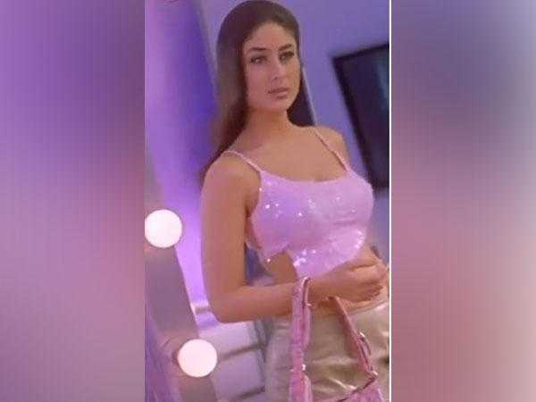

# Verbal Decade Moodboards

By {{ page.author }}

## White-Polo Paradise 30

Desert. High pillars. White, Red, Gold. Retro Blue. Olympics 1900. Travel from the ideological housing to the stadium. Shows of strength and athleticism. Imperial. Interwar. Open. The pure German displays at a high altitude, with wildflower, trimmed grass, white clothing, striped javelin Metropolis running but hardier, stronger, faster. Energy and life in the desert, running in circles, faster, faster, in army fatigue, khaki. Flags over the desert; hundreds of flags, and confetti parades. Fighters of the nation. Strong men. Building up their legs. Hot. Heat waves. Japanese Olympics. Midday heat. Hazy. Arabic. National project. Building the muscles of our youth is like building our roads, battleships, and mega-buildings. New recruits, a new small country, its history is new but timeless, a crescent bay curves out, small ships in the distance.

## 40-40 concrete rebar

Beyond Blue Eyes, dusty wasteland, concrete sticking out of sand or gravel. Junkhead start; scorching; ADAM, drysun, industrial stripes. Tokyo revengers' final desert. Rays of sunlight, making beams and walls, a little dust, tiny amounts. Squares of light. Still. Desolate, no people. Monuments, large crumbling concrete structures. Tall, criss-cross. Gamma sunlight. No dust clouds. Flat. Mountains. Desert, sand. Last remnants of massive buildings. Sense of decay levelled off to statis. Order exists. Warehouse, some machinery. Nothing complex. Working slowly. Minimalist. Remnants of steel and glass. Sunlight streams down past drydock mega structure.

## Languid Days of Progress

Willow trees, warm American air, smell of fresh wood, dry, stream nearby, deck leading down to grass, mysterious -- like a dream of academia in the countryside, populated by Americans who are looking forward, pushing forward, thinking forward. Hazy again, sunset light, ornithological drawings, pressed wildflowers. Far away from civilisation or bustling town. On the plane with Feynman to Japan, homegrown American genius. White suits, pressed trousers, brown shoes. Grandfather in Oxford.

Connected, limitless work of US engineers, interwar to 40s, 50s spectacular construction. Howard Hughes building engineering marvels, objectivism, planes; world's fastest car; empty diners, slightly desolate, pushing the limits. The south connected.

## snowdome soviet

A Czech 70s style concrete, angular, cube-like mathematical research facility; There's snow (or ash?) around the research building -- they deal in abstract and very precise squared paper and printed ink using minimalist typing devices. The people are very clean, tidy, like their thoughts and the organisation of their brains. Things fit together like blocks -- perfectly on a massive scale to amazing accuracy. Low detail -- it's far too precise for that. The perfect blankness of abstract concepts. Zero, one and infinity. Architectural schema, well-designed unbranded sketching tools.

## Logistical Stapler Empire

American officinalia: stationary stores, at the apogee of peak-office in 1984, the Mezzanine, Falling Down, Stanley Parable. The concept of germs is absent. Nothing ages. People are interchangeable like the office equipment. Everything is inventoried and has a due date. Paper moves and people shuffle, in this loose, light dance great power moves through the halls. The pages record commodities; raw material; wealth to the second, third, fourth degree in indirect language. The light is harsh. Standardisation. Standardisation. Standardisation. Codes, barcodes, entries. Block colours, sans serif American font. American Minimalism. Brown boxes with numbers roll down conveyor belts; not-digital but inventoried in huge files. Blue and white shirts. Clothing which is neither expensive nor cheap but will last as long as it is intended to.

## mainline plastic 2000

<figure></figure>

Gloss plastic, pink, yellow, dawn of mass media. Tv culture; consumerism all over; gloss lipstick and cheap clothing over bodies bursting with primal desires. Bouncing clubs, shopping extravaganzas; the empowered consumer and 'taste' in mass culture. Psychoanalytical roots in the shopping spree; clubs, drugs, and CDs. Cash is about. Writhing energy of growth, activity, like nature but financial. Sterile. No internet. K3G consumerism. Desires embraced and hypercapitsalism rampant.

## millennium desperados

All slimming down, the 2000s, and the tacky baggy suits, silver flip-phones, and sunglasses of the late 90s and early 2000s. The era of the globalist desperado, shaved head, leather jacket, unclean, raw, dangerous, relentless. Smokes. Motorcycles. Clothing, office equipment, jobs, hang loose on people ready to be interchanged. The era of disposability. Nothing lasts long but everything is abundant. 90s: still heavy, tactile. Edge and resistance. It may be shit, but it's real. There are still obscurities. The lines of the map are blurred, as are laws, business plans, nations. Action from the hotel rather than board room.

## sweet jungle ’07

Emojis, plastic, cell phones, nitrome, cute, Studiokillers, block primary colours, tamagochi turquoise / cyan / magenta. Friends. User , Hello! UI, clean and glossy. Efficient, playful, self-ordering. Chaotic, sprawling, digital consumers. Hyperactivity. Emoticons, emojis characters. No-context Japanese snacks. Early 2000s digital Japan. Freedom. Chiba. Glossy motorcycles. Electric. Consumerist and digital. Sweetness.

## tasteful app dimension 2.01

Palo Alto, SEED, oranges, yellows, crisp sharp lines. Green, blue, yellow, turquoise, plastic, easy plastic curves. Smartphone tech. Low form = fit-wear, high form = tasteful power suits, blazer white shirts, block colours. Gentle sun. Google headquarters. The power of the world on a desk with a single computer. Block colour scissors. Descendent of Japanese style computer aesthetics. High intelligence. An era without garbage, dirt, messiness. 2010s have absorbed the internet and sanitised it. Its operators wear jeans and t-shirts, eat out, have millions in the bank. They transcend the petty disputes of daily business.

&#x2042;

